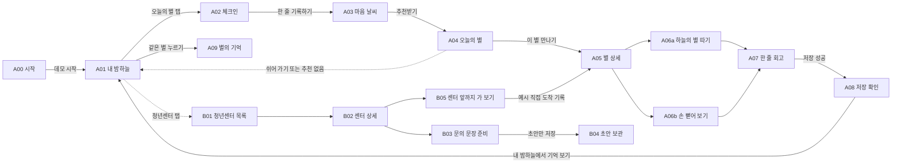

# 나란히 모바일 화면 흐름 · Figma 가이드

**시연 완료 기준**은 사용자가 오늘 할 수 있는 활동을 고르고, 시도한 일을 별에 남기고, 새로고침한 뒤 같은 별에서 그날의 회고를 다시 보는 것이다.

## Figma에 올리기

1. [화면 흐름도 SVG](나란히_화면흐름도.svg)를 Figma Design 캔버스로 드래그한다. 첫 페이지를 `00 화면 흐름`으로 이름 붙인다.
2. `01 모바일 와이어프레임` 페이지에 **390 × 844px** 프레임을 만들고, 아래 표의 이름을 붙인다. A02·A03·A04처럼 같은 URL에 있는 화면도 프로토타입에서는 상태별 프레임으로 연결한다.
3. `Prototype`에서 카드가 가리키는 버튼을 대상 프레임에 연결한다. **A00 → A09** 흐름을 먼저 만들고, A06의 두 선택이 모두 A07로 이어지는지 확인한다. A09는 A01 위에 여는 바텀시트로 연결한다.
4. 화면이 잘 열리면 청년센터(B), 오류와 도움(C)으로 같은 흐름을 확장한다. 흐름도의 한글은 글꼴이 달라도 동일하게 보이도록 벡터 윤곽선으로 만들었다. 문구를 바꿀 때는 아래 표를 복사해 Figma 텍스트 레이어에 붙인다.

[Figma Design에서 벡터 가져오기](https://help.figma.com/hc/en-us/articles/360040027794-Guide-to-imports-in-Figma-Design)

## 화면별 프레임과 전환

| Figma 프레임 | 현재 경로 | 사용자가 보는 핵심 | 주 버튼과 도착점 |
| --- | --- | --- | --- |
| A00 시작 화면 | `/` | “오늘의 작은 시도가 별이 되는 곳.” 첫 체험 안내. 시작 질문과 체험 방식은 펼쳐서 볼 수 있고, 질문 답변은 현재 추천에 반영하지 않는다. | **데모 시작** → A01. 같은 브라우저에서 돌아오면 A01로 바로 진입 |
| A01 내 밤하늘 | `/`, `/sky` | 별자리와 별의 상태. 처음에도 고를 수 있는 별을 보여준다. | **오늘의 별** 탭 → A02. 별 누르기 → A09 |
| A02 한 줄 체크인 | `/checkin` | 한 줄 입력과 활동 범위. 쉬어 가기·집 안·집 근처·바깥 중 하나를 고름 | **한 줄 기록하기** → A03 |
| A03 마음 날씨 | `/checkin` | 날씨 결과를 확인하고 사용자가 직접 바꿀 수 있음 | **오늘의 별 추천받기** → A04 |
| A04 오늘의 별 | `/checkin` | 추천한 별과 그 이유. 쉬어 가기를 골랐거나 추천이 비었으면 A01로 돌아가는 선택도 표시 | **이 별 만나기** → A05 |
| A05 별 상세 | `/stars/[starId]` | 할 일과 활동 후 남길 수 있는 두 가지 기록 방식 | **하늘의 별 따기** → A06a. **손 뻗어 보기** → A06b |
| A06a 별을 딴 기록 | 별 상세 상태 | 활동을 마쳤다는 선택 | A07로 이어짐 |
| A06b 손을 뻗은 기록 | 별 상세 상태 | 시도했다는 선택과, 필요하면 돌아온 이유 | A07로 이어짐 |
| A07 한 줄 회고 | 별 상세 상태 | 두 기록 모두 짧은 회고를 남길 수 있다. 회고 입력은 선택 | **이 순간 저장하기** → A08 |
| A08 저장 확인 | 별 상세 상태 | 서버 저장 성공 후 응원과 저장 확인 표시 | **내 밤하늘에서 기억 보기** → A01. 해당 별을 누르면 A09 |
| A09 별의 기억 | `/sky` 바텀시트 | 별의 상태, 저장 날짜, 회고. 기록이 없으면 해당 별을 시작할 수 있음 | **닫기** → A01. **이 별 다시 기록하기** → A05 |
| B01 청년센터 목록 | `/centers` | 하단 청년센터 탭에서 진입. 예시 센터는 화면에 표시 | **센터 상세 보기** → B02 |
| B02 센터 상세 | `/centers/[centerId]` | 센터 안내와 가능한 다음 행동. 상세 전용 화면은 설계안 | **문의 문장 준비하기** → B03. **앞까지 가 보기** → B05 |
| B03 문의 문장 준비 | 센터 화면 상태 | 사용자가 내용을 읽고 고칠 수 있는 문의 초안 | **초안만 저장하기** → B04 |
| B04 초안 보관 | 센터 화면 상태 | 초안 저장 완료와 다시 열기 | **저장한 초안 불러오기** → B03. **내 밤하늘** → A01 |
| B05 센터 앞까지 가 보기 | 예시 `/stars/17` | 예시 장소에서 직접 도착을 기록. 현재 센터 방문의 GPS 판정은 미연결 | 활동 기록 → A05 |

센터 목록·문의 초안은 현재 예시 모드에서 체험할 수 있다. 아래 흐름에서 센터 상세를 독립 프레임으로 잡고, 문의와 방문을 두 가지 선택지로 보여 주는 부분은 화면 설계안이다. 센터 및 문의 API를 이 화면에 연결한 뒤 실제 모드의 시연 경로로 사용한다.

## 프로토타입에서 꼭 연결할 상태

| 상태 | 화면에 보여줄 동작 |
| --- | --- |
| 불러오기 및 저장 요청 중 | 처리 중 안내를 표시하고 같은 요청을 만드는 버튼을 잠시 비활성화한다. |
| 쉬어 가기 또는 추천 없음 | 다른 활동 범위를 선택하거나 내 밤하늘로 돌아간다. |
| AI 기본값 | 기본 날씨·추천을 사용하는 경우 그 사실을 표시한다. 날씨는 사용자가 직접 바꿀 수 있다. 응원 생성에 실패해도 저장 결과는 유지한다. |
| 503 또는 저장 실패 | 입력한 글과 선택을 유지하고 같은 화면에서 재시도한다. 체크인 저장이 실패한 동안에는 추천으로 진행하지 않는다. |
| 401 또는 데모 세션 만료 | 작성 중인 글을 화면에 유지하면서 데모를 다시 시작한다. 새 세션에서 새 체크인을 저장한 뒤 추천을 요청한다. |
| 도움받을 곳 | 주 화면의 상단에 진입점을 둔다. 응답에 도움 안내가 있으면 실패 상태에서도 함께 표시한다. |

## 프레임 배치 원칙

- 하단 탭은 **내 밤하늘 · 오늘의 별 · 청년센터** 세 개로 유지한다. 마음 날씨, 추천, 회고는 해당 탭 안에서 이어지는 화면 상태다.
- `하늘의 별 따기`와 `손 뻗어 보기`는 같은 크기와 강조도로 배치한다. 둘 다 회고와 별의 기억으로 이어진다.
- 새빛·윤슬·도란은 **A01 내 밤하늘**에 배치하는 설계안으로 둔다. 세 캐릭터는 기록이 없는 첫 방문에도 볼 수 있다. 별과 캐릭터가 겹치면 별의 터치 영역을 우선한다.
- Figma에서 **A00 → A01 → A02 → A03 → A04 → A05 → A06b → A07 → A08 → A01 → A09**를 클릭해 본다. 실제 앱에서 같은 흐름을 확인할 때는 A08 이후 새로고침하고 같은 별에서 회고를 확인한다.

## 연결 원본

