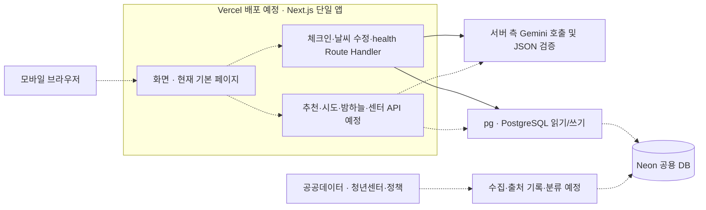

# 04 서비스 구조도

실선은 기준 커밋 3d0ddd3에 있는 서버 코드의 호출 경로다. 점선은 팀이 채택한 배포 구성 또는 구현 예정 경로다. 실선은 실환경 호출 성공을 뜻하지 않는다.

- 체크인 라우트는 모델의 날씨·위험 응답을 검증하고 규칙 결과와 합친 뒤 저장한다. 날씨 수정 라우트는 사용자 수정값을 따로 저장한다. health는 DB 조회와 키 설정 여부를 확인한다.
- web/README.md에는 공용 Neon에 스키마·시드를 적용했다고 기록되어 있다. 윤석이 외부 브라우저에서 실제 주소·세션 분리·재조회를 확인하면 배포 연결을 실선으로 갱신한다.
- 실제 사용한 공공데이터와 모델은 은비가 원문·이용 조건·호출 근거를 전달한 뒤 그림과 별첨에 같은 이름으로 기입한다.
